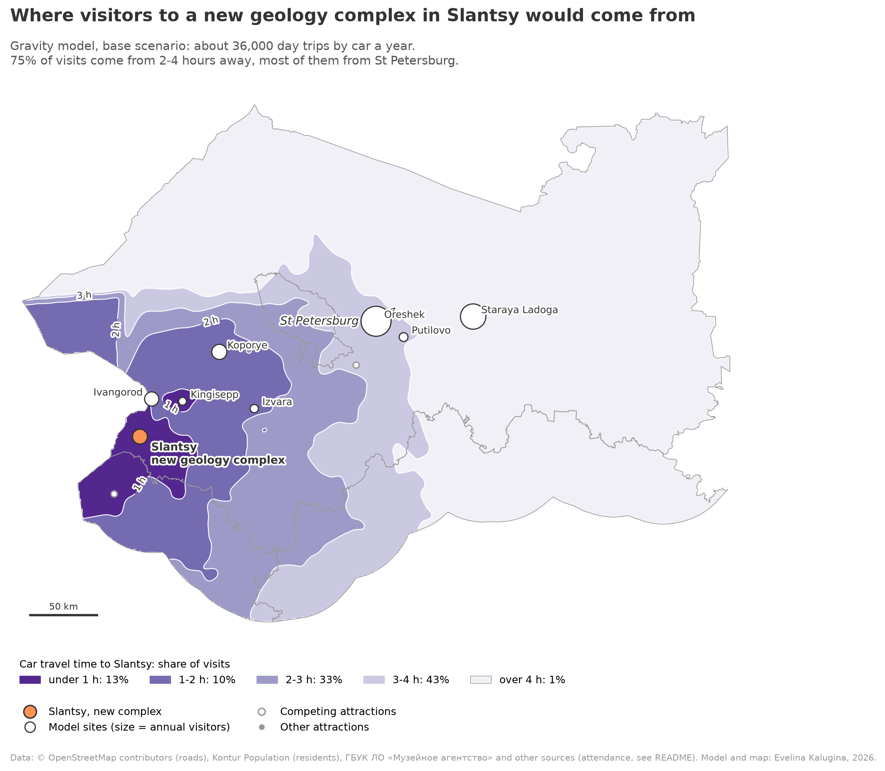
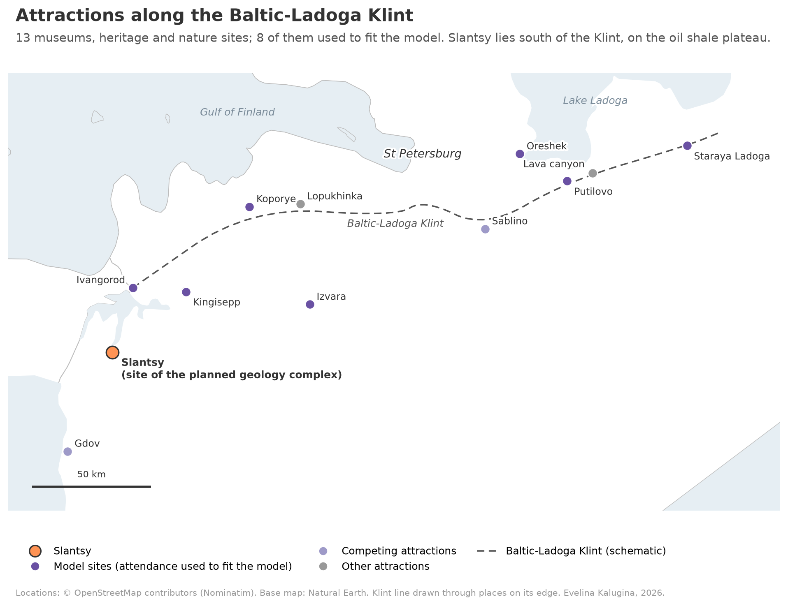
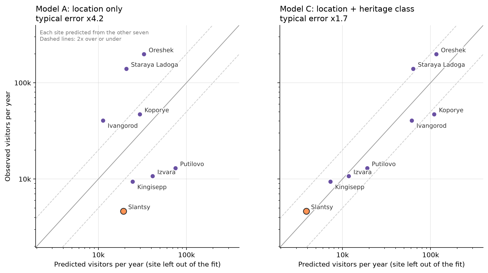
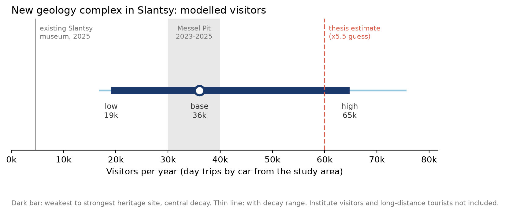

# Klint visitor demand model

**Where would visitors to a new geology museum in Slantsy come from, and how many?**

Slantsy is a small former oil shale mining town in Leningrad Oblast, near the Baltic-Ladoga Klint. My bachelor thesis designed a geology museum and research institute there and estimated 60,000 visitors a year by scaling up a nearby local museum (11,000 × 5.5). This project replaces that guess with a **gravity model** calibrated on the real attendance of museums and heritage sites along the Klint, using OpenStreetMap roads and Kontur population data.



**Interactive map:** [evelina-kalugina.github.io/klint-visitor-demand-model/klint_visitor_map.html](https://evelina-kalugina.github.io/klint-visitor-demand-model/klint_visitor_map.html) (travel-time bands, where visitors come from, attractions with attendance; click any circle for details)

## Key findings

- **Base estimate: about 36,000 day trips by car a year** (range 19,000 to 65,000). With long-distance tourists, the museum would receive about 40,000 visitors a year (19,000 to 78,000).
- **The model agrees with the closest real analogue.** Grube Messel in Germany, a UNESCO fossil site in a former oil shale pit with a visitor centre and research on site, receives about 30,000 to 40,000 visitors a year. The base estimate falls inside this range.
- **The thesis figure of 60,000 is the optimistic end, not impossible.** It is reached only if the complex performs like the strongest heritage site in the model (Staraya Ladoga).
- **The type of attraction matters far more than distance.** Heritage sites attract about 8 times more visitors than local museums in a similar location. Changing the distance decay within its uncertainty changes the result by only about ±15%.
- **Three quarters of visits would come from 2 to 4 hours away**, mostly from St Petersburg (56% of visits). People near Slantsy visit far more often (42 visits per 1,000 residents within 1 hour, against 3 per 1,000 at 3 to 4 hours), but there are few of them. So the complex must be worth a long trip, which supports a Klint tourist route and accommodation in Slantsy.
- **The existing Slantsy museum is not underperforming.** Fitted on the other 7 sites only, the model predicts its attendance within 20% (3,900 predicted, 4,645 observed in 2025). Its low numbers come from its location and type, not from the museum itself.
- **The research institute matters for jobs, not visitor numbers**: about 2,300 person-days a year on site (events, field groups, visiting researchers, interns), most of whom would need somewhere to stay.

| Scenario | Day trips by car | Museum total (with tourists) | Institute (person-days) |
|---|---|---|---|
| Low | 19,113 | 19,113 | 710 |
| **Base** | **36,015** | **39,616** | **2,300** |
| High | 64,791 | 77,750 | 5,550 |

The museum and institute lines are kept separate on purpose: interns and researchers do not buy tickets, but they need accommodation. The full table is in `data/processed/visitors_range.csv`, which feeds a separate feasibility model.

## The attractions



13 museums, heritage and nature sites along the Klint. 8 of them have reliable attendance data and are used to fit the model. The others are shown as competing attractions or for context.

## Method

1. **Attractions (01).** 13 sites geocoded with Nominatim (OpenStreetMap), with hand corrections. Each has a role: *calibration* (attendance used to fit the model), *competitor* or *context*.
2. **Population (02).** Kontur Population H3 hexagons grouped into 3,465 origins (about 5 km cells) covering St Petersburg, Leningrad Oblast and a 50 km border zone of Pskov and Novgorod oblasts: 8.27 million people.
3. **Road network (03).** Major roads from OpenStreetMap (osmnx) with speeds by road type, and a slow-zone factor of 3.0 for St Petersburg traffic.
4. **Travel times (04).** Car time from every origin to every attraction (Dijkstra shortest paths), checked against Yandex Maps on three routes (within 7 minutes).
5. **Calibration (05).** Annual visits to each site are modelled as

   visits = k × e<sup>γ·heritage</sup> × Σ<sub>origins</sub> population × e<sup>−β·travel time</sup>

   where β is the distance decay, γ the heritage-class effect and k a scale factor. The parameters are fitted on log attendance of the 8 calibration sites. The chosen model gives **β = 0.0158 per minute** (interest halves every 44 minutes of driving) and a **heritage factor of ×8.4**. Typical fit error is ×1.41, and ×1.66 in leave-one-out validation.
6. **Scenarios (06).** The new complex is placed at the existing Slantsy museum (same town centre, a few minutes apart) and treated as a heritage-class site. Low and high scenarios use the weakest (Koporye) and strongest (Staraya Ladoga) heritage site factors; base uses a typical heritage site. Distance decay is varied within its leave-one-out range.
7. **Maps (07).** Static hero map (matplotlib) and interactive map (folium) of the base-scenario catchment.





## How to reproduce

```
conda activate urban
jupyter lab
```

Run the notebooks in `notebooks/` in order (00 to 07). Raw data is not on GitHub (file size limits) and goes into `data/raw/`:

- the Kontur Population dataset for Russia (H3 hexagons), used in 02;
- the road network is downloaded by notebook 03 with osmnx and saved as `data/raw/roads_drive.graphml`. If the default Overpass server is unavailable, set `ox.settings.overpass_url` to a mirror (the notebook uses `https://maps.mail.ru/osm/tools/overpass/api`).

All processed files needed for notebooks 05 to 07 are in `data/processed/`.

Main packages: geopandas, osmnx 2.x, scipy, rasterio, matplotlib, folium.

## Repository structure

```
data/
  attractions.csv            13 attractions: role, attendance, sources
  attendance_by_year.csv     attendance by year with flags (repairs, petrol crisis)
  raw/                       (not on GitHub) Kontur population, road network
  processed/                 origins, travel times, calibration results,
                             catchment, visitors_range.csv, klint_line.geojson
docs/
  klint_visitor_map.html     interactive map (GitHub Pages)
figures/                     static maps and charts
notebooks/
  00_setup.ipynb
  01_attractions.ipynb       geocoding, Klint line, attraction map
  02_population.ipynb        Kontur H3 to origins
  03_road_network.ipynb      roads and speeds
  04_travel_times.ipynb      travel-time matrix
  05_calibration.ipynb       gravity model, heritage class, leave-one-out
  06_slantsy_scenarios.ipynb low/base/high, add-on lines, catchment
  07_maps.ipynb              hero map and interactive map
```

## Data sources

| Data | Source | Year |
|---|---|---|
| Attendance of Ivangorod, Koporye, Kingisepp, Izvara and Slantsy museums | ГБУК ЛО «Музейное агентство» (Leningrad Oblast Museum Agency), letter No. 01-16-2133/2026 of 12.11.2026; published with permission | 2019, 2023-2025 |
| Attendance of Putilovo Paleopark | Paleopark Putilovo ([paleopark.ru](https://paleopark.ru)), reply by email | 2023-2025 |
| Attendance of Staraya Ladoga Museum-Reserve | Leningrad Oblast government, via 47news.ru | 2021 |
| Attendance of Oreshek Fortress | TASS | 2023 |
| Population | Kontur Population (H3 hexagons) | |
| Roads, attraction locations | © OpenStreetMap contributors (osmnx, Nominatim) | 2026 |
| Base map for the attraction map | Natural Earth (public domain) | |
| Interactive map tiles | Esri World Light Gray Canvas, Esri World Street Map | |
| Benchmark: Grube Messel | IUCN World Heritage Outlook (2023 figure); Bauwelt; destinet.de; da.news | 2010-2025 |

Attendance data: **ГБУК ЛО «Музейное агентство»**. My thanks to the agency and to the museums that answered my requests.

## Glossary

- **Baltic-Ladoga Klint (glint):** a limestone escarpment up to about 60 m high at the northern edge of the Ordovician plateau. In Leningrad Oblast it runs about 300 km from the Narva river to the Syas river. On the maps it is drawn as a schematic line through places on its edge.
- **Gravity model:** a model in which the number of trips between two places grows with the population at the origin and falls with the distance or travel time between them.
- **Distance decay (β):** how fast interest falls with travel time. Here β = 0.0158 per minute, so each extra 44 minutes of driving halves the number of trips per resident.
- **Heritage class:** a group of major historic sites (Oreshek, Staraya Ladoga, Koporye, Ivangorod) that attract far more visitors than local museums in similar locations. In the model this is one extra factor (γ).
- **Calibration:** choosing the model parameters so that predicted attendance matches observed attendance at known sites.
- **Leave-one-out validation:** each site is removed in turn, the model is fitted on the others and then predicts the removed site. This shows how well the model predicts a place it has not seen, which is exactly the situation of a new museum.
- **Typical error ×1.66:** predictions are usually within a factor of 1.66 of the real value (for example, 6,000 to 16,600 for a true 10,000).
- **H3:** a global grid of hexagons used by Kontur to publish population data.
- **Catchment:** the area visitors come from.
- **Person-days:** one person on site for one day; used for the institute because researchers and interns stay several days.

## Limitations

- **Only 8 calibration sites.** The parameters are uncertain, which is why the result is a range and not a single number.
- **The heritage class was chosen after seeing the residuals** of the simpler model. Leave-one-out validation reduces, but does not remove, the risk of overfitting.
- **Attendance comes from different years** (2021 to 2025) and different sources. Oreshek and Staraya Ladoga figures are older and come from news reports, not official statistics.
- **Car day trips only.** Public transport, seasonality and multi-day trips are not modelled. Long-distance tourists and institute users are added as rough estimates, not modelled.
- **Kontur population is used unscaled**; it may differ from official totals.
- **Travel times are modelled**, checked on only three routes; St Petersburg traffic is a single slow-zone factor.
- **Competition between attractions is not modelled** (no Huff model). Sablino is excluded from calibration because its visitors cannot be counted.
- **The new complex uses the location of the existing museum** as a proxy for the thesis site; the difference is a few minutes by car.
- **Military history museums are excluded** because their visitors have a different motive.
- **Estonian Klint sites are not in the model**, and there are no roads outside Russia.

## License

MIT. Attendance data from ГБУК ЛО «Музейное агентство» is published with permission; please credit the agency when reusing it.
